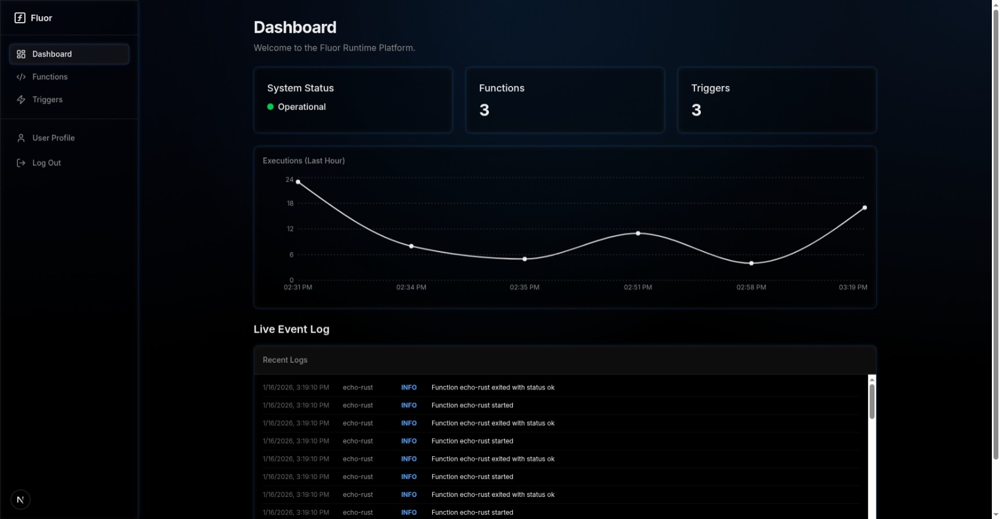

<div align="center">
  <h1>Fluor</h1>
  <p>
    <strong>Fluor is a serverless runtime built with Rust and the WebAssembly Component Model.</strong>
  </p>
  <p>

[](https://github.com/richardnas/fluor/actions?query=workflow%3ACI)
[](LICENSE)

  </p>
</div>



## What It Is

Fluor has three main parts:

- `api/`: a Rust control plane and HTTP gateway built on Actix Web and Wasmtime
- `ui/`: a Next.js dashboard for managing functions, triggers, and telemetry
- `cli/`: a command line client for the same function and trigger API

Control plane data is stored in SQLite. Telemetry is exported with OpenTelemetry and can be stored in ClickHouse.

## Current Scope

- Functions are WebAssembly components executed by Wasmtime.
- Functions are exposed through HTTP triggers.
- Authentication is JWT-based.
- The dashboard and the `fluor` CLI support function and trigger management.
- Local development uses `podman`, not Docker.

The current app-level language enum supports:

- `rust`
- `python`
- `go`
- `javascript`
- `csharp`

## Function Contract (`v2`)

Fluor no longer uses the old `handle(input: string) -> string` contract.

The current runtime expects an exported interface world equivalent to:

```wit
package fluor:fun@0.2.0;

interface handler {
    record header {
        name: string,
        value: string,
    }

    record request {
        method: string,
        path: string,
        query: option<string>,
        headers: list<header>,
        body: string,
    }

    record response {
        status: u16,
        headers: list<header>,
        body: string,
    }

    enum error-code {
        bad-request,
        unauthorized,
        forbidden,
        not-found,
        conflict,
        internal,
    }

    record error {
        code: error-code,
        message: string,
    }

    handle: func(request: request) -> result<response, error>;
}

world function {
    export handler;
}
```

This gives Fluor access to:

- HTTP method
- request path
- query string
- headers
- body
- typed success/error responses

## Supported Language Status

Template and runtime status as of April 22, 2026:

- `rust`: validated via API
- `go`: validated via API
- `python`: validated via API
- `javascript`: validated via API
- `csharp`: validated via API

## Starter Templates

Starter functions live in separate `cargo-generate` repositories:

- Rust: `cargo generate gh:richardnfag/fluor-template-rust --name my-function`
- Python: `cargo generate gh:richardnfag/fluor-template-python --name my-function`
- JavaScript: `cargo generate gh:richardnfag/fluor-template-javascript --name my-function`
- Go: `cargo generate gh:richardnfag/fluor-template-go --name my-function`
- C#: `cargo generate gh:richardnfag/fluor-template-csharp --name my-function`

The templates are meant to build WebAssembly components compatible with the contract above.

## Local Development

### Prerequisites

- Rust stable
- Node.js 22+
- `podman`
- `cargo-generate`
- `make`

Language-specific templates also require their own toolchains:

- Python: `componentize-py`
- JavaScript: `jco`
- Go: `tinygo`, `wit-bindgen-go`, `wkg`, `wasm-tools`
- C#: `.NET`, `componentize-dotnet`

### Start Infrastructure

Run only the local infra services with `podman`:

```bash
podman compose up -d clickhouse otel-collector
```

### Run the API

Build the bundled `healthz` module first:

```bash
make -C api/modules/healthz build
```

Then run the API directly:

```bash
PORT=18080 \
HOST=127.0.0.1 \
PASSWORD_PEPPER=SECRET_PEPPER \
JWT_SECRET=SECRET_JWT \
ADMIN_EMAIL=admin@example.com \
ADMIN_PASSWORD=admin \
cargo run --manifest-path api/Cargo.toml
```

Useful optional variables:

- `DATABASE_URL=sqlite:fluor.db?mode=rwc`
- `WASM_STORAGE_PATH=wasm_data`
- `HEALTHZ_WASM_PATH` overrides the seeded healthz component. The runtime image sets it to `/app/healthz.wasm`.
- `CLICKHOUSE_URL=http://127.0.0.1:8123`
- `CLICKHOUSE_USER=default`
- `CLICKHOUSE_PASSWORD=password`
- `CLICKHOUSE_DB=default`

### Run the UI

```bash
cd ui
npm install
PORT=3000 HOSTNAME=127.0.0.1 NEXT_PUBLIC_API_URL=http://127.0.0.1:18080 npm run dev
```

### Default Login

When the API seeds the database with the values above:

- email: `admin@example.com`
- password: `admin`

## Warmup and Precompiled Components

Large guest components, especially Python and JavaScript, can take a long time to compile the first time.

Fluor now handles this by:

- copying the uploaded `.wasm` into local storage
- compiling a sidecar `.cwasm` artifact for reuse
- warming functions in the background
- returning quickly instead of blocking the create/update request

If a function is invoked before warmup finishes, the API currently returns:

```text
Internal error: Function '<name>' is warming up; try again shortly
```

This is expected behavior during the first compile.

## HTTP Model

The gateway lives under `/function/*`.

Examples:

- `GET /function/healthz`
- `POST /function/my-route`

The seeded health check is:

- function: `healthz`
- trigger: `GET /healthz`

## API Examples

### Create a Function

`POST /functions` accepts JSON or multipart. The JSON form points at an existing local `.wasm` file:

```json
{
  "name": "example-rust",
  "language": "rust",
  "executable": "/absolute/path/to/example-rust.wasm",
  "cpu": "100m",
  "memory": "64Mi"
}
```

### Create a Trigger

```json
{
  "name": "example-rust-trigger",
  "method": "POST",
  "path": "/example-rust",
  "function": "example-rust"
}
```

### CLI

`cli/` builds a `fluor` binary. It talks to the same routes as the dashboard. The default server is `http://127.0.0.1:8080`; set `FLUOR_API_URL` when the API is on another port.

```bash
cargo build --manifest-path cli/Cargo.toml
export FLUOR_API_URL=http://127.0.0.1:18080

cli/target/debug/fluor functions create \
  --name example-rust \
  --language rust \
  --wasm ./example-rust.wasm

cli/target/debug/fluor triggers create \
  --name example-rust-get \
  --function example-rust \
  --method GET \
  --path /examples/rust

cli/target/debug/fluor invoke /examples/rust --query name=pencil
```

`functions`, `triggers`, and `invoke` also accept `--json`.

### Invoke a Function

```bash
curl -i -X POST http://127.0.0.1:18080/function/example-rust \
  -H 'content-type: application/json' \
  -d '{"hello":"world"}'
```

## Notes

- The README intentionally reflects the current codebase, not older examples or experiments.
- The current trigger model is HTTP-focused. If you need timers or internal events, that still needs implementation.

## Contributing

Bug reports, issues, and pull requests are welcome.

## License

Fluor is licensed under the [MIT License](LICENSE).
